# 🐺🦅 HoneyBadger — Firmware Architecture

> **Bare-Metal Firmware Architecture for an Automobile Sensor & Actuator System**
> Version 1.0 | October 2026

---

## 1. System Requirements Summary

| # | Requirement | Detail |
|---|------------|--------|
| R1 | 2 UART sensors | S1 on UART1 (500ms, P1), S2 on UART2 (250ms, P2) |
| R2 | 4 SPI sensors | S3, S4 on SPI1 (10ms/1s, P3/P4); S5, S6 on SPI2 (800ms/1.5s, P5/P6) |
| R3 | 4 I2C sensors | S7–S10 on I2C1 (450ms, P7) |
| R4 | Telemetry TX | Aggregate all sensor data → UART3 every 500ms (custom packet) |
| R5 | DC Motor PID | 2-ch optical encoder, position control via PID |
| R6 | Motor Setpoint RX | Receive position setpoint on UART3 every 5s from external device |
| R7 | No Free RTOS | Bare-metal architecture mandatory |

### Sensor Reference Table

| Sensor | Port | Sampling Time | Priority (1 = Highest) |
|--------|------|:------------:|:--------:|
| S1 | UART1 | 500 ms | 1 |
| S2 | UART2 | 250 ms | 2 |
| S3 | SPI1 | 10 ms | 3 |
| S4 | SPI1 | 1 s | 4 |
| S5 | SPI2 | 800 ms | 5 |
| S6 | SPI2 | 1.5 s | 6 |
| S7–S10 | I2C1 | 450 ms | 7 |

---

## 2. Circuit Considerations

Before designing firmware, the hardware interfaces must be understood. Below are the assumed peripheral circuits.

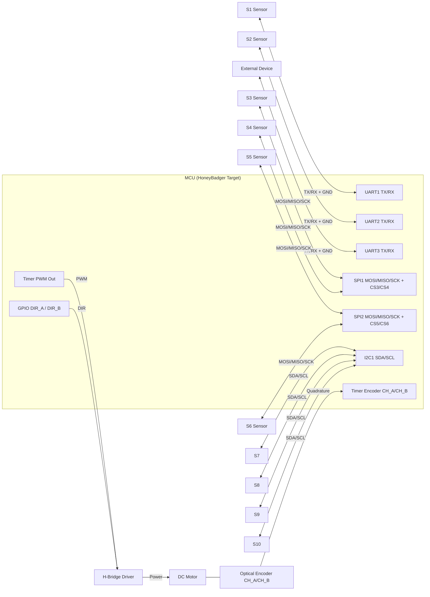

### Key Circuit Notes

| Interface | Circuit Detail |
|-----------|---------------|
| **UART1/2** | 3.3V TTL levels; TX/RX cross-connected; no flow control assumed |
| **UART3** | Full-duplex: TX for telemetry, RX for motor setpoint commands |
| **SPI1** | Shared MOSI/MISO/SCK; dedicated GPIO chip-selects CS3 (S3), CS4 (S4); CPOL/CPHA per sensor datasheet |
| **SPI2** | Same topology: CS5 (S5), CS6 (S6) |
| **I2C1** | Open-drain SDA/SCL with **4.7kΩ external pull-ups**; each sensor has a unique 7-bit address |
| **Encoder** | 2-channel (A/B) quadrature encoder; **100nF decoupling caps** on each channel; **10kΩ pull-ups** if open-collector outputs |
| **Motor Driver** | H-Bridge (e.g., L298N / DRV8871): PWM input for speed, 2× direction GPIOs (DIR_A, DIR_B); flyback diodes included on board |
| **Power** | Separate analog/digital supply planes; bulk decoupling on motor supply to isolate noise from MCU |

---

## 3. Firmware Layered Architecture

HoneyBadger uses a **4-layer modular architecture** to ensure clean separation of concerns, testability, and scalability.

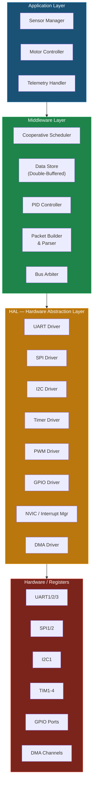

### Layer Responsibilities

| Layer | Responsibility | Key Design Rule |
|-------|---------------|-----------------|
| **Application** | Task logic: when to read which sensor, run PID, build packets | Never touches registers directly |
| **Middleware** | Scheduler, data management, PID math, packet framing, bus sharing | Reusable across projects; no HW dependency |
| **HAL** | Peripheral init, read/write, ISR entry points | Exposes clean API (`HAL_SPI_Transmit()`, etc.); portable across MCU families |
| **Hardware** | Physical registers, silicon | Accessed ONLY through HAL |

---

## 4. Timer & Interrupt Strategy

### 4.1 Timer Allocation

Since HoneyBadger is bare-metal, **timers are the heartbeat** of the system.

| Timer | Function | Configuration | Period |
|-------|----------|--------------|--------|
| **SysTick** | System tick / scheduler clock | Down-counter, interrupt | **1 ms** |
| **TIM2** | Encoder interface (quadrature) | Encoder mode (CH1 + CH2) | Free-running counter |
| **TIM3** | PWM output for motor H-Bridge | PWM mode, variable duty cycle | 20 kHz (50 μs) |
| **TIM4** | PID control loop trigger | Up-counter, interrupt | **10 ms** |

### 4.2 Interrupt Priority Map (NVIC)

> [!IMPORTANT]
> Interrupt priorities are assigned to ensure **no encoder counts are missed** and **PID timing is deterministic**.

| Priority (0 = Highest) | IRQ Source | Rationale |
|:---:|-----------|-----------|
| 0 | **TIM2 Overflow** (Encoder) | Must never miss encoder edges; fastest ISR |
| 1 | **TIM4** (PID Trigger) | Deterministic 10ms control loop |
| 2 | **SysTick** | 1ms scheduler tick; drives all task scheduling |
| 3 | **UART3 RX** | Motor setpoint reception — time-critical command |
| 4 | **UART1 RX** | S1 data reception |
| 5 | **UART2 RX** | S2 data reception |
| 6 | **DMA Complete** (UART3 TX) | Telemetry packet sent notification |
| 7 | **I2C1 Event/Error** | I2C bus event handling |

### 4.3 Interrupt Architecture Diagram

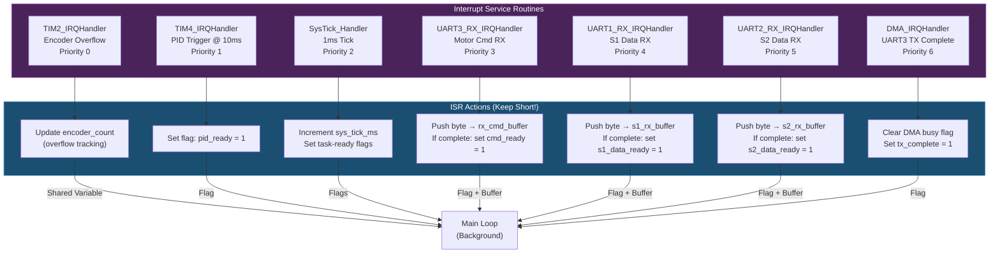

> [!TIP]
> **All ISRs follow the "Set Flag & Exit" pattern** — they do minimal work (update a counter or set a flag) and immediately return. Heavy processing happens in the main loop's task context. This keeps ISR latency low and prevents priority inversion.

---

## 5. Cooperative Scheduler Design

Since **Free RTOS is not available**, HoneyBadger implements a **Time-Triggered Cooperative (TTC) Scheduler** — a proven pattern in automotive embedded systems (MISRA-friendly, deterministic, low overhead).

### 5.1 Scheduler Core Concept

```
┌─────────────────────────────────────────────────────────┐
│  SysTick ISR (every 1ms)                                │
│  ┌─────────────────────────────────────────────────────┐ │
│  │  for each task in task_table:                       │ │
│  │      task.tick_counter++                            │ │
│  │      if (tick_counter >= task.period_ms):           │ │
│  │          task.ready = TRUE                          │ │
│  │          task.tick_counter = 0                      │ │
│  └─────────────────────────────────────────────────────┘ │
└─────────────────────────────────────────────────────────┘
                          │
                          ▼
┌─────────────────────────────────────────────────────────┐
│  Main Loop (super-loop)                                 │
│  ┌─────────────────────────────────────────────────────┐ │
│  │  while(1):                                         │ │
│  │      // Execute tasks in PRIORITY ORDER (1 first)  │ │
│  │      for each task in task_table (sorted by prio): │ │
│  │          if (task.ready):                          │ │
│  │              task.execute()                        │ │
│  │              task.ready = FALSE                    │ │
│  │                                                    │ │
│  │      // PID runs from its own timer flag           │ │
│  │      if (pid_ready):                               │ │
│  │          PID_Execute()                             │ │
│  │          pid_ready = FALSE                         │ │
│  │                                                    │ │
│  │      // Kick watchdog                              │ │
│  │      WDG_Refresh()                                 │ │
│  └─────────────────────────────────────────────────────┘ │
└─────────────────────────────────────────────────────────┘
```

### 5.2 Task Table Configuration

The scheduler is **table-driven** — adding a new sensor requires only a new row in the table.

```c
/* HoneyBadger Scheduler Task Table */
typedef struct {
    const char*  name;           // Human-readable name
    uint16_t     period_ms;      // Scheduling period
    uint8_t      priority;       // 1 = highest
    void         (*execute)(void); // Task function pointer
    volatile uint16_t tick_count; // Current tick accumulator
    volatile uint8_t  ready;     // Ready flag (set by SysTick ISR)
} WF_Task_t;

WF_Task_t task_table[] = {
  // Name           Period  Prio  Handler             Tick  Ready
  { "S1_UART1",      500,    1,   Task_Read_S1,        0,    0 },
  { "S2_UART2",      250,    2,   Task_Read_S2,        0,    0 },
  { "S3_SPI1",        10,    3,   Task_Read_S3,        0,    0 },
  { "S4_SPI1",      1000,    4,   Task_Read_S4,        0,    0 },
  { "S5_SPI2",       800,    5,   Task_Read_S5,        0,    0 },
  { "S6_SPI2",      1500,    6,   Task_Read_S6,        0,    0 },
  { "I2C_S7toS10",   450,    7,   Task_Read_I2C_All,   0,    0 },
  { "UART3_TX",      500,    0,   Task_Telemetry_TX,   0,    0 }, // Priority 0 = system-critical
};
#define NUM_TASKS  (sizeof(task_table) / sizeof(task_table[0]))
```

### 5.3 Scheduler Tick Diagram (First 1500ms)

| Time (ms) | S3 (10) | S2 (250) | I2C (450) | S1 (500) | TX (500) | S5 (800) | S4 (1000) | S6 (1500) |
|:---------:|:-------:|:--------:|:---------:|:--------:|:--------:|:--------:|:---------:|:---------:|
| 0 | ✅ | ✅ | ✅ | ✅ | ✅ | ✅ | ✅ | ✅ |
| 10 | ✅ | | | | | | | |
| 20 | ✅ | | | | | | | |
| ... | ✅ | | | | | | | |
| 250 | ✅ | ✅ | | | | | | |
| 450 | ✅ | | ✅ | | | | | |
| 500 | ✅ | ✅ | | ✅ | ✅ | | | |
| 800 | ✅ | | | | | ✅ | | |
| 900 | ✅ | | ✅ | | | | | |
| 1000 | ✅ | ✅ | | ✅ | ✅ | | ✅ | |
| 1350 | ✅ | | ✅ | | | | | |
| 1500 | ✅ | ✅ | | ✅ | ✅ | | | ✅ |

### 5.4 CPU Budget Analysis (Worst-Case Coincidence)

At **t = 0** (and every LCM tick), all tasks fire simultaneously:

| Task | Est. Duration | Notes |
|------|:------------:|-------|
| S3 read (SPI1) | ~150 μs | SPI @ 1 MHz, 16-bit read + CS toggle |
| S4 read (SPI1) | ~150 μs | Sequential with S3 (shared bus) |
| S5 read (SPI2) | ~150 μs | Independent bus, can overlap with SPI1 conceptually |
| S6 read (SPI2) | ~150 μs | Sequential with S5 (shared bus) |
| S7–S10 read (I2C) | ~2000 μs | 4 sensors × 500μs each @ 400kHz |
| S1 cmd+rx (UART1) | ~100 μs | Send command; RX via interrupt |
| S2 cmd+rx (UART2) | ~100 μs | Send command; RX via interrupt |
| PID compute | ~50 μs | Fixed-point arithmetic |
| Telemetry TX build | ~150 μs | Packet assembly; DMA handles actual TX |
| **Total** | **~3000 μs** | **3 ms out of 10 ms budget ✅** |

> [!NOTE]
> Worst-case total is **~3 ms**, well within the **10 ms** deadline imposed by S3's sampling rate. This leaves **7 ms of idle time** (70% CPU headroom) for future expansion.

---

## 6. Main Flow — Complete Block Diagram

This is the **master block diagram** showing the full firmware flow from power-on to steady-state operation.

```mermaid
flowchart TD
    RESET["🔌 Power-On / Reset"]
    RESET --> CLOCK["Clock Configuration<br/>HSE → PLL → SYSCLK"]
    CLOCK --> GPIO_INIT["GPIO Initialization<br/>Pin modes, AF mappings,<br/>CS pins, DIR pins"]
    GPIO_INIT --> PERIPH_INIT["Peripheral Initialization"]

    subgraph PERIPH_INIT_DETAIL["Peripheral Init Sequence"]
        direction TB
        P1["HAL_UART_Init(UART1, baud)<br/>HAL_UART_Init(UART2, baud)<br/>HAL_UART_Init(UART3, baud)"]
        P2["HAL_SPI_Init(SPI1, mode, clk)<br/>HAL_SPI_Init(SPI2, mode, clk)"]
        P3["HAL_I2C_Init(I2C1, 400kHz)"]
        P4["HAL_TIM_Encoder_Init(TIM2, CH1+CH2)<br/>HAL_TIM_PWM_Init(TIM3, 20kHz)<br/>HAL_TIM_Base_Init(TIM4, 10ms)"]
        P5["HAL_DMA_Init(UART3_TX_CH)"]
        P6["NVIC_SetPriority() for all IRQs<br/>NVIC_EnableIRQ() for all IRQs"]
        P1 --> P2 --> P3 --> P4 --> P5 --> P6
    end

    PERIPH_INIT --> PERIPH_INIT_DETAIL

    PERIPH_INIT_DETAIL --> SCHED_INIT["Scheduler Init<br/>Load task_table<br/>Reset tick counters"]
    SCHED_INIT --> DATA_INIT["Data Store Init<br/>Clear double-buffers<br/>Reset sensor_data[]"]
    DATA_INIT --> PID_INIT["PID Init<br/>Kp, Ki, Kd = defaults<br/>setpoint = 0<br/>integral = 0"]
    PID_INIT --> WDG_INIT["Watchdog Init<br/>IWDG, timeout ~2s"]
    WDG_INIT --> SYSTICK_START["Start SysTick (1ms)<br/>Start TIM2 (Encoder)<br/>Start TIM3 (PWM, duty=0)<br/>Start TIM4 (PID trigger)<br/>Enable UART RX Interrupts"]

    SYSTICK_START --> MAIN_LOOP

    subgraph MAIN_LOOP["♻️ Main Super-Loop (while 1)"]
        direction TB
        CHK_PID{"pid_ready<br/>flag set?"}
        CHK_PID -- Yes --> EXEC_PID["PID_Execute()<br/>Read encoder via TIM2<br/>Compute error<br/>Update PWM duty<br/>Clear flag"]
        CHK_PID -- No --> CHK_CMD

        EXEC_PID --> CHK_CMD{"cmd_ready<br/>flag set?"}
        CHK_CMD -- Yes --> PARSE_CMD["Parse Motor Command<br/>Validate CRC<br/>Update PID setpoint<br/>Clear flag"]
        CHK_CMD -- No --> CHK_TASKS

        PARSE_CMD --> CHK_TASKS

        subgraph CHK_TASKS["Task Dispatcher (Priority-Ordered)"]
            direction TB
            T_TX{"UART3_TX<br/>ready? P0"}
            T_TX -- Yes --> DO_TX["Build HoneyBadger Packet<br/>Copy from data_store<br/>Compute CRC16<br/>HAL_DMA_Start(UART3_TX)<br/>Clear flag"]
            T_TX -- No --> T1

            DO_TX --> T1

            T1{"S1 ready?<br/>P1"}
            T1 -- Yes --> DO_S1["HAL_UART_SendCmd(UART1)<br/>// RX handled by ISR<br/>Store S1 data → data_store<br/>Clear flag"]
            T1 -- No --> T2

            DO_S1 --> T2

            T2{"S2 ready?<br/>P2"}
            T2 -- Yes --> DO_S2["HAL_UART_SendCmd(UART2)<br/>Store S2 data → data_store<br/>Clear flag"]
            T2 -- No --> T3

            DO_S2 --> T3

            T3{"S3 ready?<br/>P3"}
            T3 -- Yes --> DO_S3["BusArbiter_Lock(SPI1)<br/>HAL_GPIO_Write(CS3, LOW)<br/>HAL_SPI_TransmitReceive(SPI1)<br/>HAL_GPIO_Write(CS3, HIGH)<br/>BusArbiter_Unlock(SPI1)<br/>Store S3 → data_store<br/>Clear flag"]
            T3 -- No --> T4

            DO_S3 --> T4

            T4{"S4 ready?<br/>P4"}
            T4 -- Yes --> DO_S4["BusArbiter_Lock(SPI1)<br/>HAL_GPIO_Write(CS4, LOW)<br/>HAL_SPI_TransmitReceive(SPI1)<br/>HAL_GPIO_Write(CS4, HIGH)<br/>BusArbiter_Unlock(SPI1)<br/>Store S4 → data_store<br/>Clear flag"]
            T4 -- No --> T5

            DO_S4 --> T5

            T5{"S5 ready?<br/>P5"}
            T5 -- Yes --> DO_S5["BusArbiter_Lock(SPI2)<br/>CS5 LOW → SPI2 Xfer → CS5 HIGH<br/>BusArbiter_Unlock(SPI2)<br/>Store S5 → data_store<br/>Clear flag"]
            T5 -- No --> T6

            DO_S5 --> T6

            T6{"S6 ready?<br/>P6"}
            T6 -- Yes --> DO_S6["BusArbiter_Lock(SPI2)<br/>CS6 LOW → SPI2 Xfer → CS6 HIGH<br/>BusArbiter_Unlock(SPI2)<br/>Store S6 → data_store<br/>Clear flag"]
            T6 -- No --> T7

            DO_S6 --> T7

            T7{"I2C S7-S10<br/>ready? P7"}
            T7 -- Yes --> DO_I2C["for sensor in S7,S8,S9,S10:<br/>  HAL_I2C_Read(I2C1, addr)<br/>  Store → data_store<br/>Clear flag"]
            T7 -- No --> IDLE["Idle / WDG_Refresh()"]

            DO_I2C --> IDLE
        end

        CHK_TASKS --> WDG["WDG_Refresh()"]
    end

    WDG --> CHK_PID

    style RESET fill:#c0392b,stroke:#e74c3c,color:#fff
    style MAIN_LOOP fill:#0d1b2a,stroke:#1b263b,color:#e0e1dd
    style CHK_TASKS fill:#1b2a4a,stroke:#2e4a7a,color:#e0e1dd
    style PERIPH_INIT_DETAIL fill:#2c3e50,stroke:#34495e,color:#ecf0f1
```

---

## 7. Sensor Management Detail

### 7.1 UART Sensors (S1, S2) — Interrupt-Driven Reception

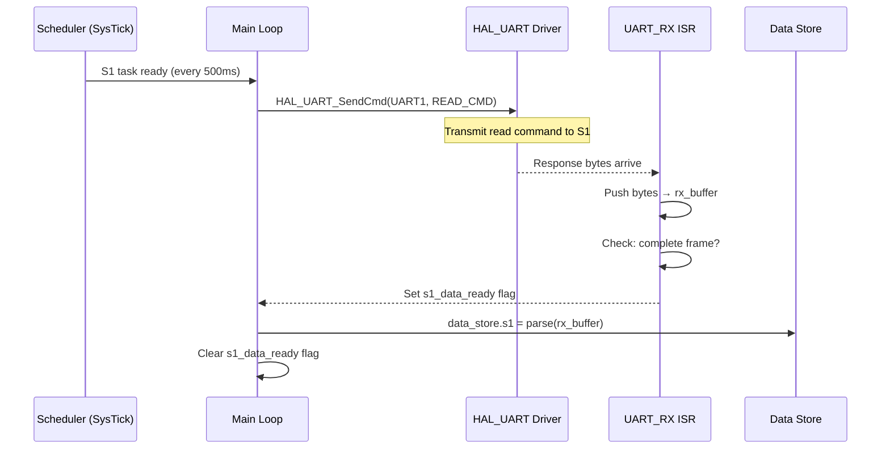

### 7.2 SPI Sensors (S3–S6) — Polled with Bus Arbitration

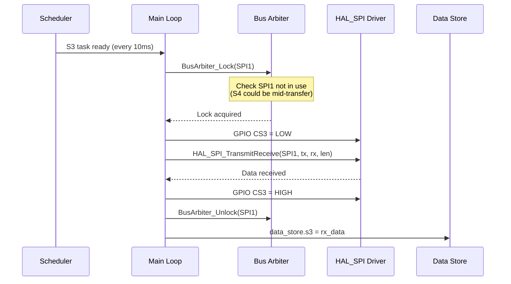

> [!IMPORTANT]
> **Bus Arbitration** ensures S3 and S4 (sharing SPI1) never access the bus simultaneously. In a cooperative scheduler, this is guaranteed by design (no preemption in task context), but the arbiter provides **defensive safety** and is essential if the architecture ever migrates to preemptive scheduling.

### 7.3 I2C Sensors (S7–S10) — Sequential Polling

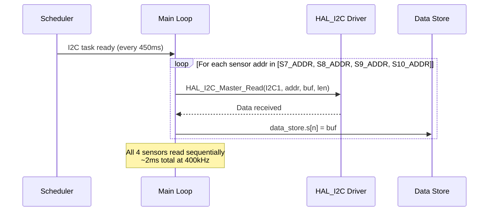

### 7.4 Double-Buffered Data Store

To prevent **race conditions** between sensor writers and the telemetry packet builder:

```
┌──────────────────────────────────────────────────┐
│              Data Store (Double-Buffer)           │
│                                                  │
│  Buffer A (Active Write)    Buffer B (Read-Only) │
│  ┌──────────────────┐      ┌──────────────────┐  │
│  │ s1:  [latest]    │      │ s1:  [snapshot]  │  │
│  │ s2:  [latest]    │      │ s2:  [snapshot]  │  │
│  │ s3:  [latest]    │  ──► │ s3:  [snapshot]  │  │
│  │ ...              │ SWAP │ ...              │  │
│  │ s10: [latest]    │      │ s10: [snapshot]  │  │
│  │ timestamp: T     │      │ timestamp: T-1   │  │
│  └──────────────────┘      └──────────────────┘  │
│                                                  │
│  Swap occurs atomically before UART3 TX task     │
│  Telemetry reads from Buffer B (stable snapshot) │
│  Sensor tasks write to Buffer A (no conflict)    │
└──────────────────────────────────────────────────┘
```

---

## 8. PID Motor Position Control

### 8.1 Control Loop Architecture

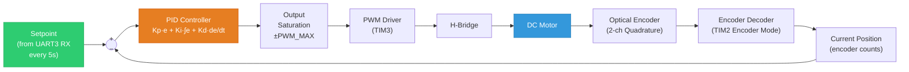

### 8.2 PID Execution (Every 10ms — TIM4 ISR Flag)

```c
/* Executed in main loop when pid_ready flag is set by TIM4 ISR */
void PID_Execute(void) {
    // 1. Read current position from encoder
    int32_t current_pos = (int32_t)TIM2->CNT + encoder_overflow_count * 65536;

    // 2. Compute error
    int32_t error = pid.setpoint - current_pos;

    // 3. Proportional term
    int32_t p_term = pid.Kp * error;

    // 4. Integral term with anti-windup
    pid.integral += error;
    if (pid.integral > pid.integral_max) pid.integral = pid.integral_max;
    if (pid.integral < -pid.integral_max) pid.integral = -pid.integral_max;
    int32_t i_term = pid.Ki * pid.integral;

    // 5. Derivative term (with low-pass filter)
    int32_t derivative = error - pid.prev_error;
    int32_t d_term = pid.Kd * derivative;
    pid.prev_error = error;

    // 6. Compute output & saturate
    int32_t output = p_term + i_term + d_term;
    output = CLAMP(output, -PWM_MAX, PWM_MAX);

    // 7. Set motor direction and PWM
    if (output >= 0) {
        HAL_GPIO_Write(DIR_A, HIGH);
        HAL_GPIO_Write(DIR_B, LOW);
        HAL_PWM_SetDuty(TIM3, (uint16_t)output);
    } else {
        HAL_GPIO_Write(DIR_A, LOW);
        HAL_GPIO_Write(DIR_B, HIGH);
        HAL_PWM_SetDuty(TIM3, (uint16_t)(-output));
    }
}
```

### 8.3 Encoder Interface Detail

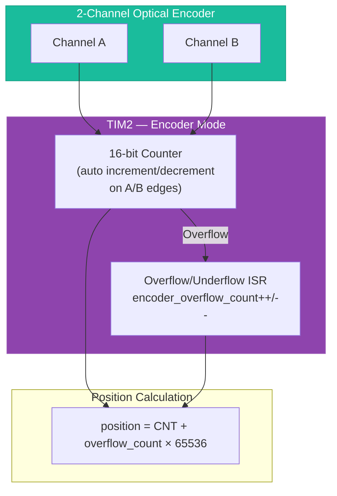

> [!NOTE]
> **Why Timer Encoder Mode?** Hardware encoder mode captures both edges of both channels automatically in silicon — no CPU cycles needed. The ISR only fires on counter overflow, which is rare. This gives **zero missed counts** even at high RPM.

---

## 9. Custom UART3 Data Packet — HoneyBadger Telemetry Protocol

### 9.1 Packet Structure (TX: MCU → External Device, Every 500ms)

```
 ╔═══════════════════════════════════════════════════════════════════════════════╗
 ║                    HoneyBadger Telemetry Packet v1.0                           ║
 ╠═══════╦════════╦════════╦════════╦══════════╦═══════════════╦════════╦═══════╣
 ║  SOF  ║ PKT_ID ║ SEQ_NO ║ LENGTH ║ TSTAMP   ║   PAYLOAD     ║ CRC16  ║  EOF  ║
 ║ 0xAA  ║ 1 byte ║ 1 byte ║ 2 bytes║ 4 bytes  ║  N bytes      ║ 2 bytes║ 0x55  ║
 ╠═══════╬════════╬════════╬════════╬══════════╬═══════════════╬════════╬═══════╣
 ║ Fixed ║ 0x01=  ║ Rolling║ Payload║ ms since ║ 10 × Sensor   ║ CRC-16 ║ Fixed ║
 ║ Start ║ Tele-  ║ 0-255  ║ byte   ║ boot     ║ Data Blocks   ║ (CCITT)║ End   ║
 ║ Frame ║ metry  ║ counter║ count  ║ (32-bit) ║ (see below)   ║        ║ Frame ║
 ╚═══════╩════════╩════════╩════════╩══════════╩═══════════════╩════════╩═══════╝
```

### 9.2 Sensor Data Block (Repeated per Sensor)

```
 ┌───────────┬──────────┬──────────┬─────────────────┐
 │ SENSOR_ID │  STATUS  │ DATA_LEN │      DATA       │
 │  1 byte   │  1 byte  │  1 byte  │  1–8 bytes      │
 └───────────┴──────────┴──────────┴─────────────────┘

 SENSOR_ID:  0x01=S1, 0x02=S2, ... 0x0A=S10
 STATUS:     0x00=OK, 0x01=Timeout, 0x02=CRC_Error, 0x03=Not_Ready
 DATA_LEN:   Number of data bytes (sensor-specific, 1–8)
 DATA:       Raw sensor reading (little-endian)
```

### 9.3 Motor Setpoint Command Packet (RX: External Device → MCU, Every 5s)

```
 ┌───────┬────────┬─────────────────┬────────┬───────┐
 │  SOF  │ CMD_ID │    POSITION     │ CRC8   │  EOF  │
 │ 0xBB  │ 0x01   │   4 bytes (LE)  │ 1 byte │ 0x55  │
 └───────┴────────┴─────────────────┴────────┴───────┘

 SOF:       0xBB (distinguishes from telemetry packet)
 CMD_ID:    0x01 = Set Position
 POSITION:  32-bit signed encoder count target (little-endian)
 CRC8:      CRC-8/MAXIM over CMD_ID + POSITION
 EOF:       0x55
```

### 9.4 Example Telemetry Packet (Hex Dump)

```
AA 01 2F 00 3C E8 03 00 00    ← SOF, PKT_ID=Telemetry, SEQ=47, LEN=60, TSTAMP=1000ms
01 00 02 1A 2B               ← S1: ID=1, Status=OK, Len=2, Data=0x2B1A
02 00 02 3C 4D               ← S2: ID=2, Status=OK, Len=2, Data=0x4D3C
03 00 04 DE AD BE EF         ← S3: ID=3, Status=OK, Len=4, Data=0xEFBEADDE
04 01 00                     ← S4: ID=4, Status=Timeout, Len=0 (no data)
05 00 02 11 22               ← S5: ID=5, Status=OK, Len=2
06 00 02 33 44               ← S6: ID=6, Status=OK, Len=2
07 00 02 55 66               ← S7: ID=7, Status=OK, Len=2
08 00 02 77 88               ← S8: ID=8, Status=OK, Len=2
09 00 02 99 AA               ← S9: ID=9, Status=OK, Len=2
0A 00 02 BB CC               ← S10: ID=10, Status=OK, Len=2
D7 3E                        ← CRC16-CCITT over bytes [PKT_ID...last data]
55                            ← EOF
```

### 9.5 Packet Build & Transmit Flow

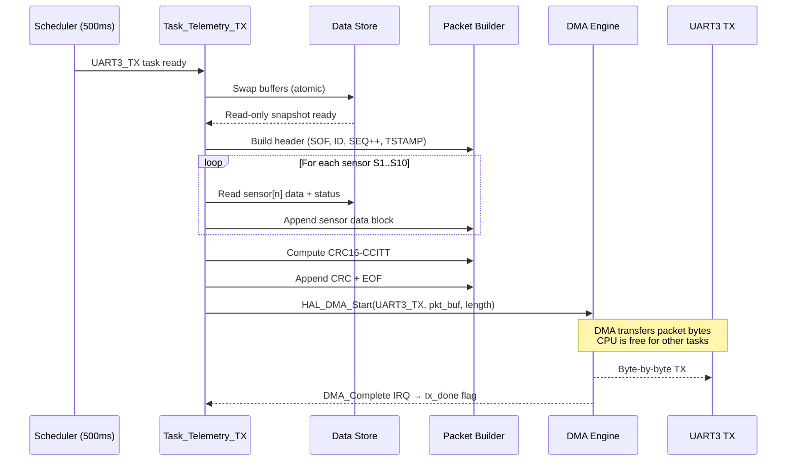

---

## 10. Error Handling & Safety

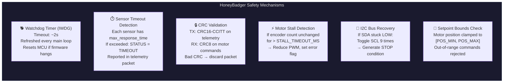

---

## 11. Scalability & Flexibility

### 11.1 Design for Change

| Change Scenario | How HoneyBadger Handles It |
|----------------|------------------------|
| **Add new sensor** | Add one row to `task_table[]`; implement `Task_Read_SN()`; add entry in data store — no scheduler changes needed |
| **Change sampling rate** | Modify `period_ms` in the task table entry — zero code changes |
| **Change priority** | Modify `priority` field — scheduler auto-reorders |
| **Add new communication bus** | Add HAL driver module; register bus in arbiter — middleware unchanged |
| **Switch MCU family** | Only HAL layer needs porting; application and middleware are MCU-agnostic |
| **Migrate to RTOS** | Each task becomes an RTOS task; scheduler replaced by RTOS kernel; task functions reuse as-is |
| **Add CAN bus** | Add HAL_CAN driver; add CAN TX task to table — existing tasks unaffected |
| **Tune PID** | Update Kp, Ki, Kd values; could be made runtime-configurable via UART3 commands |

### 11.2 Modularity Map

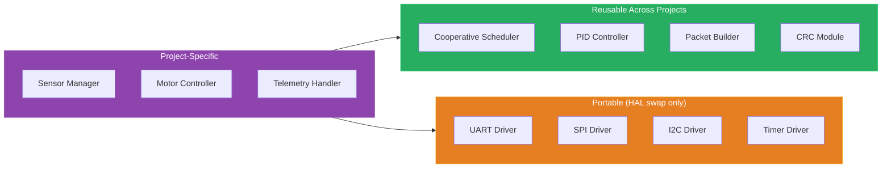

---

## 12. Features Summary & Design Rationale

| Feature | Implementation | Why This Approach? |
|---------|---------------|-------------------|
| **TTC Scheduler** | Table-driven cooperative scheduler with SysTick | Deterministic, zero overhead, MISRA-friendly, proven in automotive |
| **Priority-Ordered Dispatch** | Main loop iterates tasks by priority | Ensures critical sensors (P1) always serviced first on conflicts |
| **Bus Arbitration** | Software lock/unlock for shared SPI/I2C | Prevents bus contention; enables safe future migration to RTOS |
| **Double-Buffered Data Store** | Two alternating buffers with atomic swap | Eliminates race conditions between sensor writes and telemetry reads |
| **DMA for UART3 TX** | DMA channel handles byte transmission | Frees CPU during large telemetry packet transmission (~60 bytes) |
| **Hardware Encoder Mode** | TIM2 in quadrature encoder mode | Zero CPU overhead for position tracking; no missed edges |
| **PID with Anti-Windup** | Integral clamping + output saturation | Prevents integral wind-up during large setpoint changes or stalls |
| **CRC on All Packets** | CRC16-CCITT (TX), CRC8 (RX) | Ensures data integrity over UART; detects bit errors |
| **Watchdog Timer** | Independent WDG, ~2s timeout | Last-resort safety: resets MCU if firmware deadlocks |
| **Sensor Status Flags** | Per-sensor status in telemetry packet | External device knows if a sensor reading is stale/failed |
| **Modular HAL** | Clean API abstraction over registers | Enables MCU portability; testable with mock HAL |

---

## 13. File/Module Structure

```
HoneyBadger/
├── Core/
│   ├── main.c                    // Entry point, init sequence, main loop
│   ├── startup.s                 // Vector table, reset handler
│   └── syscalls.c                // System stubs
├── HAL/
│   ├── hal_uart.c / .h           // UART init, TX, RX, IRQ handlers
│   ├── hal_spi.c / .h            // SPI init, transfer
│   ├── hal_i2c.c / .h            // I2C init, master read/write
│   ├── hal_timer.c / .h          // Timer init, encoder, PWM
│   ├── hal_gpio.c / .h           // GPIO config, read/write
│   ├── hal_dma.c / .h            // DMA init, start, ISR
│   └── hal_nvic.c / .h           // Interrupt priority, enable/disable
├── Middleware/
│   ├── scheduler.c / .h          // TTC scheduler, task table, dispatcher
│   ├── data_store.c / .h         // Double-buffered sensor data storage
│   ├── pid_controller.c / .h     // PID algorithm with anti-windup
│   ├── packet_builder.c / .h     // HoneyBadger telemetry packet assembly
│   ├── packet_parser.c / .h      // Motor command packet parsing
│   ├── bus_arbiter.c / .h        // SPI/I2C bus lock management
│   └── crc.c / .h                // CRC16-CCITT and CRC8 implementations
├── Application/
│   ├── sensor_tasks.c / .h       // Task_Read_S1..S10 implementations
│   ├── motor_control.c / .h      // PID execution, encoder reading
│   └── telemetry.c / .h          // Telemetry TX task, command RX handler
├── Config/
│   ├── wf_config.h               // Pin mappings, clock defines, baud rates
│   ├── sensor_config.h           // Sensor addresses, data lengths, timeouts
│   └── pid_config.h              // PID gains, limits, PWM range
└── Docs/
    └── HoneyBadger_Architecture.md  // This document
```

---

> [!TIP]
> **Key Differentiators of HoneyBadger Architecture:**
> 1. **No RTOS dependency** — fully bare-metal with automotive-grade TTC scheduler
> 2. **Table-driven design** — add sensors by adding table rows, not rewriting code
> 3. **Hardware encoder mode** — zero-miss position tracking at zero CPU cost
> 4. **DMA offloading** — CPU freed during UART3 telemetry transmission
> 5. **Defense-in-depth safety** — WDG + CRC + timeouts + stall detection + bounds checking
> 6. **70% CPU headroom** — room for significant future expansion
> 7. **Portable architecture** — only HAL layer changes when switching MCU families
